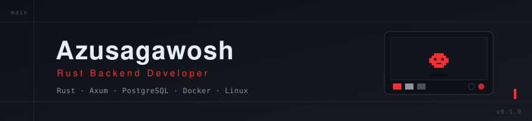

  

 

## Azusagawosh

Rust Backend Developer.

Строю надёжные backend-сервисы на Rust. Изучаю системный дизайн, асинхронность и архитектуру.

 

  
  
  
  
  
  
  
  

 

  
  
  

 

## Проекты

- **Flow** — CLI-инструмент для управления проектами.
- **Cafe Manager Pro** — Full-stack приложение (Rust + React + Docker).

 

  
  

